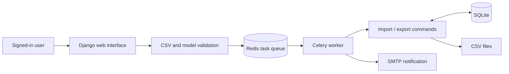

<div align="center">

# ⚙️ Automate Tools DJ

### Less repetitive data entry. More time for useful work.

A Django toolkit for importing CSV data, exporting database records, and running data tasks in the background.

<p>
  
  
  
  
</p>

**[Get started](#getting-started)** · **[Import a CSV](#csv-format)** · **[Use the CLI](#command-line-tools)** · **[Project structure](#project-structure)**

</div>

---

Automate-Tools-DJ brings common data operations into a browser-based workspace. Sign in, choose a Django model, and submit a CSV import or export. Celery handles queued work, while management commands provide a direct path for terminal workflows.

## Features

| 📥 Import | 📤 Export | ⚡ Automate |
| --- | --- | --- |
| Upload CSV files through the web interface | Export model records to CSV | Queue work with Celery and Redis |
| Select a model from installed apps | Generate timestamped output files | Email import-completion notices |
| Check CSV headers against model fields | Run exports from the command line | Email export attachments |
| Store uploaded files and model names | Included Student, Customer, and Employee models | Store task results with django-celery-results |

Django's built-in authentication powers signup, login, logout, and access checks on the automation pages.

## How it works



Web requests enqueue the operation; a success message on the page does not confirm that the background task has finished. Inspect the worker output for completion or errors.

## Getting started

### 1. Clone and create an environment

Use Python 3.10 or newer as a starting point for local development. The repository was generated with Django 5.0.6 and does not currently include a pinned dependency manifest.

```bash
git clone https://github.com/Harsh-shah10/Automate-Tools-DJ.git
cd Automate-Tools-DJ
python -m venv .venv
```

Activate the environment:

```bash
# macOS / Linux
source .venv/bin/activate
```

```powershell
# Windows PowerShell
.\.venv\Scripts\Activate.ps1
```

Install the packages referenced by the source. This is a starting dependency set, rather than a tested lockfile:

```bash
python -m pip install 'Django>=5.0,<5.1' 'celery[redis]>=5.4,<5.5' django-celery-results python-decouple
```

### 2. Configure the environment

Create `.env` in the repository root. All values below are read by [`projectx/settings.py`](projectx/settings.py):

```dotenv
SECRET_KEY=replace-with-a-generated-local-secret
DEBUG=True
EMAIL_HOST=smtp.example.com
EMAIL_PORT=587
EMAIL_HOST_USER=your-smtp-username
EMAIL_HOST_PASSWORD=your-smtp-password
DEFAULT_FROM_EMAIL=sender@example.com
DEFAULT_TO_EMAIL=recipient@example.com
```

Use your SMTP provider's actual settings. TLS is enabled in the Django configuration. Notifications go to **`DEFAULT_TO_EMAIL`**, rather than automatically to the signed-in user's address.

For a local secret, generate a value with:

```bash
python -c "from django.core.management.utils import get_random_secret_key; print(get_random_secret_key())"
```

The default database is `db.sqlite3`. Redis is configured directly in settings at `redis://127.0.0.1:6379`; changing it requires editing `CELERY_BROKER_URL` there.

### 3. Start Redis and prepare storage

If you have Docker, run Redis locally with:

```bash
docker run --name automate-tools-redis -p 127.0.0.1:6379:6379 -d redis:7-alpine
```

A native Redis instance on the same address also works. This repository does not include a Dockerfile or Compose stack for the Django application.

Create the output directory and apply migrations:

```bash
python -c "from pathlib import Path; Path('media/exported_data').mkdir(parents=True, exist_ok=True)"
python manage.py migrate
```

### 4. Start the worker and web server

In one terminal, with the virtual environment activated:

```bash
celery -A projectx worker --loglevel=info
```

In a second terminal, activate the same environment and run:

```bash
python manage.py runserver
```

For Celery workers on Windows, use a Linux environment such as WSL and make the database and media paths accessible to both the worker and Django.

Open [localhost:8000/signup/](http://localhost:8000/signup/), create an account, and log in. Visit [the automation workspace](http://localhost:8000/automate/) to import or export data.

## Web routes

| Route | Purpose | Sign-in required |
| --- | --- | --- |
| `/` | Public home page | No |
| `/signup/` | Register an account | No |
| `/login/` | Sign in | No |
| `/logout/` | Sign out | Yes |
| `/automate/` | Automation home | Yes |
| `/automate/importdata/` | Upload a CSV and select a model | Yes |
| `/automate/exportdata/` | Select a model for export | Yes |
| `/automate/celerytest/` | Queue a test email to the configured recipient | Yes |

## CSV format

Import headers must match **all model field names in their exact order**, including primary keys. For the included `Student` model:

```csv
id,roll_no,name,age
1,101,Alex Example,20
2,102,Sam Example,21
```

Save this as `students.csv`, choose `Student` in the import form, and upload it. Use IDs suitable for your database: imports call `save()` for each row, so an existing primary key can update a record.

| Model | Expected header |
| --- | --- |
| `Student` | `id,roll_no,name,age` |
| `Customer` | `id,phone,name,age` |
| `Employee` | `employee_id,employee_name,designation,salary,retirement,other_benefits,total_benefits,total_compensation` |

The current format is **CSV**, even where notification text refers to an Excel sheet. Native `.xlsx` import is not implemented.

## Command-line tools

Run from the repository root with your environment activated:

```bash
# Import matching CSV rows directly into a model
python manage.py importdata /path/to/students.csv Student

# Export all records for a model
python manage.py exportdata Student

# Run the dedicated Student exporter
python manage.py exportstudata
```

`exportdata` writes timestamped CSVs under `media/exported_data/`. `exportstudata` writes to the current directory and uses display headers, so its output does not match the generic importer's required header format.

Direct management commands run synchronously and do not send the Celery task's notification emails. They still require the environment settings used during Django startup.

## Implementation notes

<details>
<summary><strong>Read before relying on automated imports and exports</strong></summary>

- **Shared data:** authentication protects automation pages, but model records and uploads are not scoped to individual accounts. Model discovery exposes installed models beyond the three example data models.
- **Import behavior:** header validation runs before import; rows are saved individually without a transaction wrapping the entire file. A later failure can leave earlier rows saved. The importer does not call model `full_clean()` on each row.
- **Export directory:** create `media/exported_data/` before exporting; the exporter does not create it itself.
- **Attachment path:** `export_data_task` generates a second timestamped path after the export command finishes. If the timestamp changes between those calls, the email attachment lookup can fail even though the CSV was created. The command and task need to share the actual output path to resolve this.
- **Recipient:** all task notifications use the single configured `DEFAULT_TO_EMAIL` address.
- **Task visibility:** there is no browser task-progress screen; use worker logs to diagnose failed work.
- **Tests:** the app test files are scaffolds. The setup and end-to-end flows have not been executed as part of this README update.

</details>

## Project structure

```text
Automate-Tools-DJ/
├── accounts/                 Signup, login, logout, and account templates
├── dataentry/
│   ├── management/commands/  CSV import/export and example commands
│   ├── migrations/           Student, Customer, and Employee schema
│   ├── templates/            Automation pages and feedback messages
│   ├── models.py             Example data models
│   ├── tasks.py              Background operations and email tasks
│   ├── utils.py              Model lookup, CSV checks, and output paths
│   └── views.py              Protected import/export workflows
├── uploads/                  Uploaded-file records
├── projectx/
│   ├── celery.py             Celery configuration
│   ├── settings.py           Database, SMTP, Redis, and environment settings
│   └── urls.py               Application routes
└── manage.py                 Django management entry point
```

## Development checks

With dependencies installed and `.env` configured:

```bash
python manage.py check
python manage.py test accounts dataentry uploads
python manage.py makemigrations --check --dry-run
```

For a manual smoke check, import a small Student CSV, inspect the worker logs, export `Student`, and verify the generated file and notification. Existing test files do not yet provide application coverage.

---

<div align="center">

**Import → Process → Export → Notify**

[Back to setup](#getting-started) · [Explore the source](https://github.com/Harsh-shah10/Automate-Tools-DJ)

</div>
